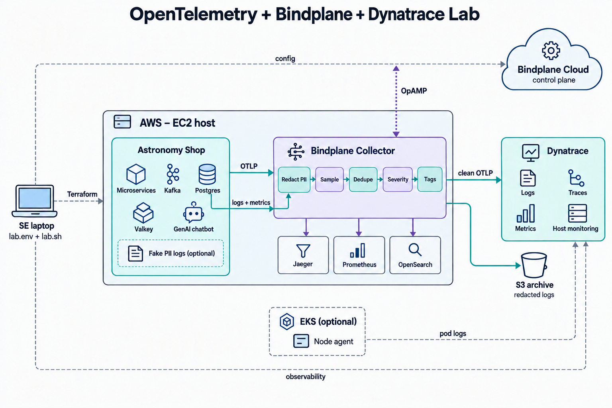

# OTel Astronomy Shop + Bindplane + Dynatrace

A ready-to-demo environment that shows what a Bindplane-managed OpenTelemetry collector does to telemetry
*before* it reaches Dynatrace: masking PII, cutting noisy logs, fixing severities, adding host context, and
archiving the cleaned logs to S3. It runs in **your** AWS account, **your** Bindplane project and **your** Dynatrace
tenant, configured from one settings file.



## What you can show

| Story | What happens | Where to see it |
|---|---|---|
| PII never leaves the host | Card numbers and emails are hashed (same card = same hash), CVVs masked, in logs and spans. The fake PII comes from two optional sources you switch on for the demo: a synthetic log generator (`./lab.sh pii on`) and the shop's `emitRawPii` flag (spans) | Dynatrace logs/traces, S3 objects |
| Less noise, lower cost | ~45-50% fewer proxy access logs, duplicate Docker logs dropped, Kafka logs sampled 1 in 10 (never WARN/ERROR) | Collector counters, dashboard *2. Bindplane value* |
| Logs with meaning | INFO/WARN/ERROR derived from envoy status codes, message text and syslog priority | Dynatrace logs |
| Shared-tenant hygiene | Environment and namespace tags added in flight; optionally every service renamed `<your prefix>name` | Any Dynatrace view |
| Host monitoring with OTel | Dynatrace's OTel host recipe in the collector; host and process entities | Infrastructure & Operations |
| Collector health | Each collector reports its own metrics and logs | Dynatrace *OpenTelemetry Collector* dashboard |
| One pipeline, many backends | Same data to Dynatrace, Jaeger, Prometheus, OpenSearch and S3 | Shop UI `/jaeger/ui/`, `/grafana/` |

The step-by-step demo script is in [DEMO.md](DEMO.md); every processor is explained in
[docs/processors-guide.md](docs/processors-guide.md).

## Before you start (one-time, by hand)

1. **Tools on your laptop:** `terraform` (>= 1.5), `aws` CLI v2 + the Session Manager plugin, the
   [`bindplane` CLI](https://docs.bindplane.com/cli-and-api/cli/installation), `python3` with PyYAML
   (`python3 -m pip install --user pyyaml`), `curl`. Optional: `dtctl` (Dynatrace automation and checks),
   `kubectl` + `helm` (EKS add-on).
2. **AWS:** credentials that can create EC2, IAM roles and instance profiles, SSM parameters and S3 buckets in one
   region. The host uses the account's default VPC.
3. **Bindplane Cloud:** any project you can use, a shared one included: every resource the lab creates is named
   `<LAB_NAME>-…` (e.g. `otel-bindplane-lab-shop-agent`), so labs with different `LAB_NAME`s never touch each other
   or anything else in the project. From it you need:
   - an **API key** (Project Settings > API Keys) and, for project-scoped `bps_…` keys, the **project ID**,
   - the **secret key** (Collectors > Install Collector: the value after `-s` in the install command).
4. **Dynatrace:**
   - an **access token** with `openTelemetryTrace.ingest`, `metrics.ingest`, `logs.ingest`,
   - the **OpenTelemetry Host Monitoring** extension installed from Hub (for host and process entities),
   - optional: a `dtctl` context for the tenant (`dtctl auth login`), so `lab.sh` can create the OpenPipeline routes
     and the dashboards for you.

## Quickstart

```bash
cp lab.env.example lab.env      # fill in: names, AWS, Dynatrace, Bindplane (lab.env is git-ignored)
./lab.sh doctor                 # checks tools, values, and that every credential works
./lab.sh up                     # ~15 min: Bindplane -> AWS -> collector connected -> Dynatrace
./lab.sh check                  # after ~10 min of data: end-to-end verification
./lab.sh info                   # shop, load generator, feature flags, chatbot, Grafana, Jaeger URLs
```

Preparing a demo: switch the fake PII logs on at least 15 minutes before, so there is history to show, and off
afterwards (see [DEMO.md](DEMO.md)):

```bash
./lab.sh pii on                 # synthetic checkout/payment logs with fake cards and emails, ~4 orders/min
./lab.sh pii off
```

`./lab.sh up` runs these steps, each of which can be re-run on its own:

| Step | What it does |
|---|---|
| `bindplane` | Fills the templates in `bindplane/` from `lab.env`, applies processors, bundles, destinations and the `<LAB_NAME>-shop-agent` configuration (all named `<LAB_NAME>-…`), starts the rollout |
| `infra` | Terraform: shop host (Ubuntu 24.04, `m6i.xlarge`), IAM role, security group (port 8080 from `UI_ALLOWED_CIDR` only), S3 bucket, Bindplane secret key as an SSM SecureString, optional Elastic IP (`ENABLE_ELASTIC_IP`) |
| `wait` | Waits until the host has installed Docker and the collector, and the collector is connected |
| `dynatrace` | Adds one OpenPipeline route per signal to the OTel Host Monitoring pipelines (only entries named after `LAB_NAME` are touched) and creates or updates the three dashboards |
| `eks` | Only with `ENABLE_EKS=true`: the shop and a Bindplane node agent on an existing EKS cluster |

On the host, the user data clones the demo, adds the lab overlay (`shop/`), points the services' OTLP at the
collector, installs the collector with your secret key (read from SSM at boot, never in user data) and starts the
shop. Bootstrap log: `./lab.sh shell`, then `sudo tail -f /var/log/cloud-init-output.log`.

## Settings (`lab.env`)

Every value is documented in [lab.env.example](lab.env.example). The ones that matter most:

| Setting | Why |
|---|---|
| `LAB_NAME`, `DEPLOYMENT_ENV` | Make them yours: they keep your AWS resources and data apart from everyone else's. Dashboards, checks and routes find your data by `DEPLOYMENT_ENV` |
| `ENABLE_SERVICE_PREFIX`, `SERVICE_PREFIX` | Off by default (service names stay as the shop sends them). Turn on in a tenant where another Astronomy Shop already reports the same service names, and set your own prefix, e.g. your initials: `JD-LAB-` |
| `UI_ALLOWED_CIDR` | The shop UI (including the feature-flag and load-generator pages) is reachable from this range only |
| `DT_ENV_URL` | The environment URL used for OTLP (`https://<id>.live.dynatrace.com`), not the `apps` URL |
| `ENABLE_S3_ARCHIVE`, `ENABLE_EKS` | Turn the optional parts on or off |
| `ENABLE_PII_GENERATOR` | Off by default. The synthetic PII log generator is always installed but only runs when you switch it on: `./lab.sh pii on` / `off` / `status`, at any time and without a rebuild. `true` makes `./lab.sh up` switch it on at the end |

## Cost and teardown

- **AWS:** about USD 5 per day while running (`m6i.xlarge`, 60 GB gp3; S3 is negligible and expires
  after 7 days). `./lab.sh down` destroys everything Terraform created.
- **Dynatrace:** the shop is chatty (roughly 10k spans per minute plus logs and metrics). Run it for the demo, not
  for weeks, on a tenant where that consumption is fine.
- `./lab.sh down` keeps the Bindplane resources and the Dynatrace routes and dashboards, so the next `up` is quick.
  `./lab.sh clean` removes this lab's Bindplane resources (every `<LAB_NAME>-…` resource any option may have created)
  and its OpenPipeline routes. Two things are left for you in the UI: the three `<LAB_NAME> | …` dashboards in
  Dynatrace, and the shop host's collector, which stays listed as *Disconnected* in Bindplane (Collectors > delete).

## Tested

Validated end to end on 2026-11-23 from an empty setup: AWS `us-east-1`, a shared Bindplane Cloud project, and a
Dynatrace SaaS tenant. `./lab.sh up` → `check` (all green: collector connected, ~94k spans and ~10k logs per 10 min,
0 raw PII, envoy logs -40%, host entity, S3 archive) → `pii on/off` → `down` → `clean`, with the service prefix and
S3 archive on and EKS off. Collector: BDOT 1.110.2; shop: opentelemetry-demo 3.1.0.

## Security notes

- No credentials in the repository: `lab.env`, `.build/` and Terraform state are git-ignored. Terraform state holds
  the Bindplane secret key (as part of the SSM parameter): keep the state local and delete it after `down`.
- No SSH: the host is reached with SSM Session Manager (`./lab.sh shell`). Only port 8080 is open.
- The PII is fake (test card numbers, `example.com` addresses) and only produced when you switch it on; every
  synthetic record carries `lab.synthetic=true`.
- Hashing card numbers without a secret salt is pseudonymisation, fine for this demo data and not for real PANs.

## Repository layout

```
lab.sh                 the only entry point
lab.env.example        every setting, documented
bindplane/             Bindplane resources as templates (processors, bundles, destinations, configurations)
terraform/             AWS: shop host, IAM, S3 archive, SSM parameter; user data builds the host
shop/                  overlay for opentelemetry-demo 3.1.0: compose override, optional PII log generator
dynatrace/             OpenPipeline routes and dashboard generator (dtctl)
eks/                   optional EKS add-on: Helm values for the shop, Bindplane node agent manifest
scripts/render.py      fills the Bindplane templates from lab.env
docs/                  processors guide
DEMO.md                demo script
TROUBLESHOOTING.md     known issues and fixes
```

Troubleshooting and known limitations: [TROUBLESHOOTING.md](TROUBLESHOOTING.md).
